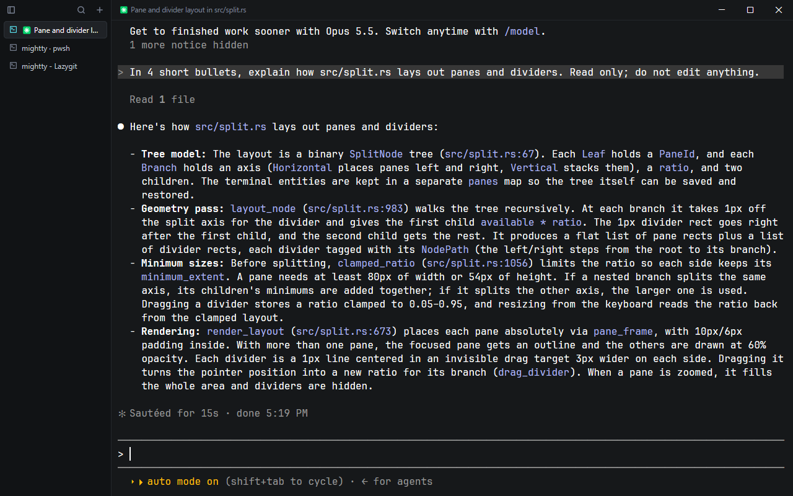
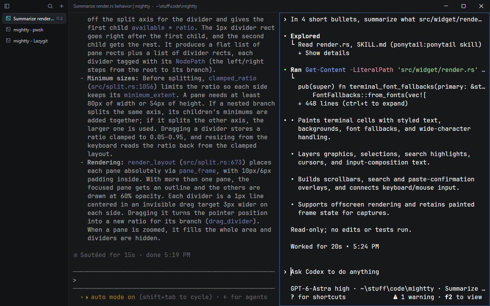
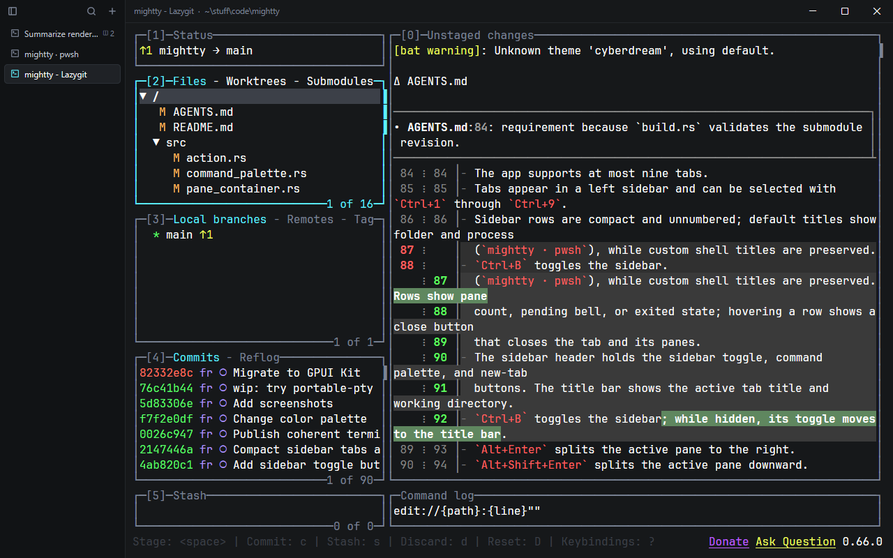
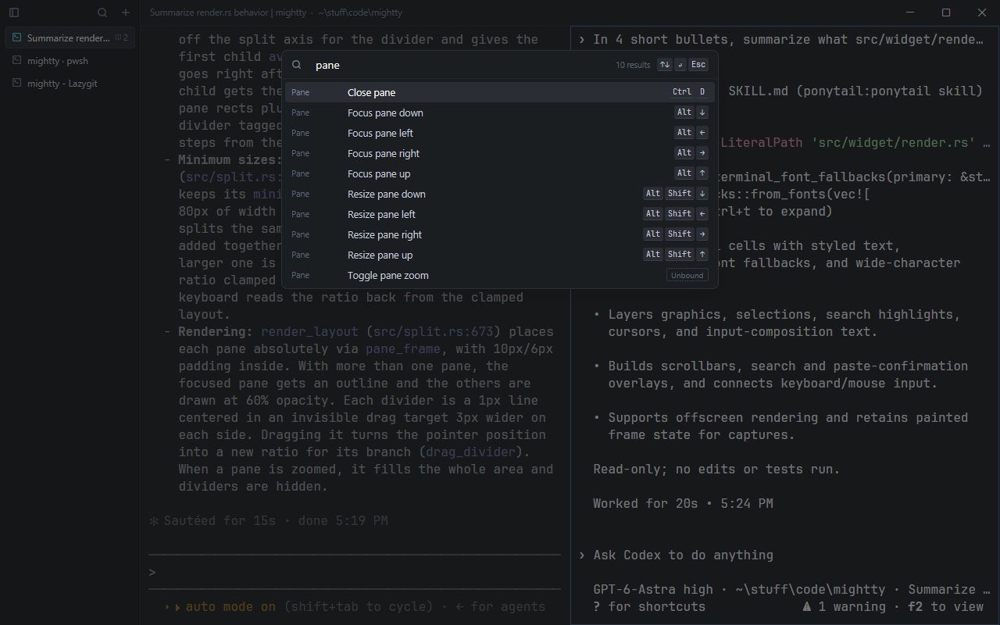
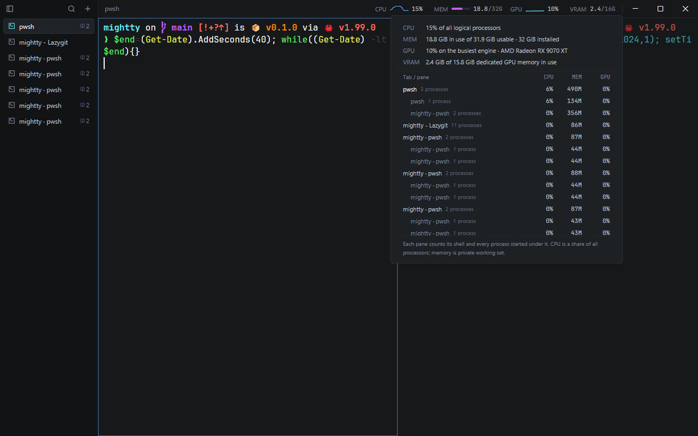

# mightty

A fast, GPU-rendered terminal for Windows that you can drive entirely from the
command line, by hand, from scripts, or from an AI agent.



mightty is built in Rust on [GPUI Kit](https://github.com/longbridge/gpui-kit)
and [Ghostty](https://github.com/ghostty-org/ghostty)'s `libghostty-vt` terminal
engine. It targets Windows first (ConPTY), with a Unix shell bridge (forkpty)
behind the same interface.

## Screenshots

Claude Code and Codex side by side. The focused pane is outlined and the other
is dimmed.



lazygit in one of several tabs.



The command palette, showing each command's category and shortcut.



Live CPU, memory, GPU, and VRAM usage in the title bar. Hover the meters for
usage per pane, grouped by tab.



## Why mightty

- **Everything is scriptable.** Every tab, pane, window, keystroke, and pixel is
  reachable through `mightty ctl`. Anything you can do with the keyboard and
  mouse, a script or agent can do too, and get structured JSON back.
- **Built for AI agents.** Agents can open panes, run commands, wait for output,
  read the screen, and take lossless screenshots without guessing. IDs never
  silently fall back to the wrong target, and every reply says exactly what
  happened.
- **A real terminal underneath.** Ghostty's VT engine handles escape sequences,
  so modern TUIs like Claude Code, Codex, and lazygit render correctly.

## Control mightty from the CLI

`mightty ctl` talks to a running mightty instance. Add `--json` to any command
for machine-readable output.

```powershell
# What's running?
mightty ctl instances --json
mightty ctl state --json          # windows, tabs, panes, sizes, titles, processes

# Open a pane to the right (the reply names the new pane, here p2) and run a command in it
mightty ctl pane split --pane p1 --direction right --cwd C:\work
mightty ctl pane send-text --pane p2 --text "cargo test"
mightty ctl pane send-key --pane p2 --key Enter

# Wait for a result, then read what the terminal shows
mightty ctl wait --pane p2 --text "test result" --timeout 60s
mightty ctl pane read --pane p2 --tail 50

# Capture the pane exactly as it renders: PNG plus cell data and state
mightty ctl snapshot --pane p2 --out .\captures
```

Inside a mightty pane, commands default to that pane. Every shell gets
`MIGHTTY_INSTANCE_ID`, `MIGHTTY_WINDOW_ID`, `MIGHTTY_TAB_ID`, and
`MIGHTTY_PANE_ID`, so an agent running in mightty can run
`mightty ctl pane read --tail 100` without looking up any IDs.

### What you can do

| Area | Commands |
| --- | --- |
| Discover | `instances`, `state`, `capabilities`, `profiles` |
| Tabs | `tab new`, `tab select`, `tab move`, `tab close` |
| Panes | `pane split`, `pane resize`, `pane focus`, `pane zoom`, `pane scroll`, `pane close` |
| Terminal input | `pane send-text`, `pane send-key`, `pane input` (ordered text and key steps) |
| Terminal output | `pane read` (viewport or tail, as text or styled cells) |
| Windows and UI | `window focus`, `window resize`, `ui sidebar`, `ui palette`, `ui search` |
| Real UI events | `ui key`, `ui text`, `ui pointer`, `ui input` (clicks, drags, selections) |
| Synchronize | `wait` (for text, process exit, title, layout, overlay, settings) and `events` (live change stream) |
| Capture | `snapshot` of a window, tab, or pane |

Run `mightty ctl --help` for every argument, or
`mightty ctl capabilities --json` for the full machine-readable contract:
operations, arguments, error codes, and limits.

### Why it's safe to automate

- **No guessing.** Stale or ambiguous pane, tab, window, or instance IDs fail
  with an error. They never fall back to a different target.
- **Honest replies.** Each JSON reply has `ok`, a `result` or a typed `error`,
  and an `effect` (`none`, `committed`, `partial`, or `unknown`), so callers
  know whether anything changed.
- **Waits instead of sleeps.** `wait` blocks until text appears, a process
  exits, or a layout settles. `--after-output` ignores text that was already
  on screen.
- **Race-free layout changes.** Pass `--if-layout TOKEN` to a layout mutation
  and it fails cleanly if the layout changed since you last looked.
- **Observation has no side effects.** Reading state, reading output, and
  offscreen snapshots don't change focus, selection, scroll position, or
  terminal size.
- **Pixel-exact screenshots.** Snapshots read back the GPU frame, so other
  windows can't cover them, and rendering bugs show up exactly as the user saw
  them. Each bundle also has matching cell data, state, environment, and
  diagnostics.

### Disposable test instances

Start a separate GUI instance with its own settings and storage, no global
hotkeys, and no default-terminal registration:

```powershell
mightty --test-instance --data-dir C:\temp\mightty-case
```

Pass `--instance ID` to `ctl` commands when more than one instance is running.
`mightty ctl state --saved` reads the last persisted state even after the
instance has exited.

The CLI control transport and pixel capture are Windows-only for now. See the
[control and diagnostics contract](docs/control-and-diagnostics-design.md) for
targeting rules, input encoding, waits, event streams, snapshot modes, and the
wire protocol.

## Features

**Terminal**
- Ghostty's `libghostty-vt`, built from a pinned source submodule
- Scrollback, mouse reporting, hyperlinks, a scrollbar, and full-scrollback search
- Text selection by drag, word, line, or rectangle
- Safe paste with confirmation for risky content
- Kitty graphics protocol
- Native IME text composition
- Embedded JetBrainsMono Nerd Font Mono

**Layout**
- Up to nine tabs in a compact sidebar
- Split panes with draggable dividers, directional focus, resize, and zoom
- Named workspaces you can save and restore

**Customization**
- Typed profiles, themes, fonts, and key bindings with safe live reload
- A command palette listing every action with its shortcut

**Windows integration**
- Single-process app with a persistent quick-terminal window
- Live CPU, memory, GPU, and VRAM usage in the title bar, read from the same
  kernel counters as Task Manager and sampled only while the window is visible
- Hover the usage meters for CPU, memory, and GPU use per pane, grouped by tab
- Signed MSIX packages, AppInstaller updates, and default-terminal support
- PowerShell and Bash shell integration for titles, working directories, and
  prompt navigation

## Getting started

### Requirements

- Rust with edition 2024 support
- Git, for the pinned Ghostty submodule
- Zig `0.16.0` (pinned in `.mise.toml`)
- Windows 10 version 1809 or newer, or a Unix platform
- The JetBrainsMono Nerd Font Mono files in `fonts/JetBrainsMono/` (not
  vendored): `JetBrainsMonoNerdFontMono-Regular.ttf`, `-Bold.ttf`,
  `-Italic.ttf`, and `-BoldItalic.ttf`

### Build and run

```bash
git submodule update --init ghostty
mise install
mise exec -- cargo run
```

For a release build, use `mise exec -- cargo build --release`.

`mise exec --` makes the pinned Zig visible to Cargo. You can instead put Zig
on `PATH` or set `ZIG` to its path and run Cargo directly.

The default shell is `pwsh.exe` on Windows. On Unix it's `$SHELL`, falling back
to `/bin/sh`.

## Keyboard shortcuts

On macOS, use `Cmd` in place of `Ctrl` and `Cmd+Option` in place of `Alt`.

| Shortcut | Action |
| --- | --- |
| `Ctrl+T` | New tab (up to nine) |
| `Ctrl+1` … `Ctrl+9` | Switch to a tab |
| `Ctrl+B` | Show or hide the sidebar |
| `Alt+Enter` | Split right |
| `Alt+Shift+Enter` | Split down |
| `Alt+Arrow` | Focus the adjacent pane |
| `Alt+Shift+Arrow` | Resize the active pane |
| `Ctrl+D` | Close the pane, or the tab if it has one pane |
| `Ctrl+Shift+C` / `Ctrl+Shift+V` | Copy / paste (`Cmd+C` / `Cmd+V` on macOS) |
| `Ctrl+Shift+F` | Search scrollback (`Cmd+F` on macOS) |
| `Ctrl+Shift+P` | Command palette |
| `Ctrl+Shift+F12` | Save a diagnostic capture to `captures/` (Windows) |
| `Cmd+Q` | Quit (macOS) |

With the mouse: drag to select, double-click for a word, triple-click for a
line, and hold `Ctrl+Alt` (`Option` on macOS) while dragging for a rectangle.
Drag split dividers to resize. The mouse wheel scrolls history.

Sidebar rows show the folder and process (such as `mightty · pwsh`) or a custom
shell title, plus the pane count, a pending bell, or an exited shell. Hover a
row to close its tab.

## Documentation

- [Settings](docs/settings.md): profiles, themes, fonts, key bindings, live reload
- [Workspaces](docs/workspaces.md): saving and restoring layouts
- [Shell integration](docs/shell-integration.md): PowerShell and Bash prompt markers and directories
- [Windows distribution](docs/windows-distribution.md): MSIX packages, updates, default terminal
- [Control and diagnostics](docs/control-and-diagnostics-design.md): the full `mightty ctl` contract
- [Ghostty integration](docs/ghostty-integration.md): bindings, safety invariants, updating Ghostty
- [Feature roadmap](docs/feature-roadmap.md)
- [portable-pty experiment](docs/pty-experiment.md): an optional comparison with WezTerm's PTY library

## Development

```bash
mise exec -- cargo fmt --all -- --check
mise exec -- cargo clippy --all-targets -- -D warnings
mise exec -- cargo test
```

Windows GUI checks run against a disposable instance after `cargo build`:

```bash
pwsh -NoProfile -File tools/control-smoke.ps1
pwsh -NoProfile -File tools/control-smoke.ps1 -SnapshotOnly
mise exec -- cargo run --example capture_fidelity
```

After changing the Ghostty submodule revision or its C headers, regenerate the
private bindings (requires `libclang`):

```bash
mise exec -- cargo run --manifest-path tools/ghostty-bindings/Cargo.toml
```

### How it's built

- `build.rs` compiles Ghostty's VT library from the local `ghostty/` submodule
  with Zig and links it statically. Nothing is fetched at build time, and there
  are no `libghostty-vt` crate dependencies.
- Every build checks the submodule against the commit and header fingerprint
  in `src/ghostty/bindings.version`.
- Debug builds use Zig `ReleaseSafe`; release builds use `ReleaseFast`. Run with
  `--features ghostty-debug` to enable Ghostty's integrity checks.
- Terminal I/O is wake-driven: a reader thread blocks on the PTY, wakes a GPUI
  task, and that task feeds the output to Ghostty in bounded batches before
  repainting.
- The [GPUI patch](vendor/gpui/MIGHTTY-PATCH.md) adds text commit and Direct3D
  frame readback used by input injection and snapshots.

<details>
<summary>Project layout</summary>

```text
src/
├── main.rs              # App entry point and window lifecycle
├── action.rs            # Typed actions, bindings, and menus
├── command_palette.rs   # Palette filtering and entries
├── control.rs           # `mightty ctl` CLI, protocol, and transport
├── diagnostics.rs       # State persistence, process sampling, and logs
├── snapshot.rs          # GPU frame capture and diagnostic bundles
├── ui_control.rs        # Keyboard, pointer, and text injection
├── pane_container.rs    # Tabs, sidebar, workspaces, and action dispatch
├── split.rs             # Split tree and pane geometry
├── system_usage/       # Title-bar CPU, memory, and GPU meters (Windows counters)
├── settings.rs          # Typed settings and safe reload
├── profile.rs           # Profiles and shell launch values
├── shell_integration.rs # Shell metadata and integration setup
├── workspace.rs         # Saved workspace layouts
├── application/         # Activation, IPC, quick terminal, COM handoff
├── widget/              # Terminal widget: PTY bridge, input, rendering, search, graphics, capture
├── ghostty/             # Safe wrappers over Ghostty's C API (raw bindings in ffi.rs)
└── shell/               # ConPTY (Windows) and forkpty (Unix)
tools/                   # Binding generator, packaging, and smoke tests
packaging/windows/       # MSIX, AppInstaller, and COM proxy inputs
shell-integration/       # PowerShell and Bash integration scripts
```

</details>

## License

Project code is MIT-licensed. Adapted code and third-party attribution are in
[`THIRD_PARTY_NOTICES.md`](THIRD_PARTY_NOTICES.md).
